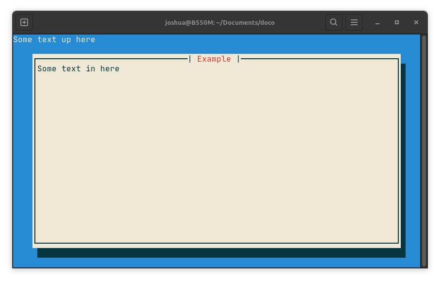
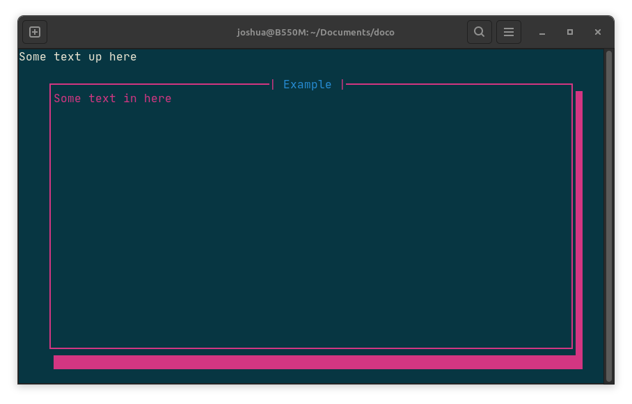

# Revo

Tiny ncurses wrapper for Ada.




[example.adb](./src/example.adb) contains a small example program to demonstrate some Revo code.

## Dependencies

- gnat
- gprbuilder
- libncurses-dev (equivalent for your distribution)

## Usage

I want to avoid the headache of packages and just use the source files directly.

1. Clone the repository and add the path of the [revo](./revo/) directory to your project's ```Source_Dirs```

3. Make sure you have ```"C"``` in your project's ```Languages```.

4. Link with the ncurses C library by adding the following code to your project file:

```ada
package Linker is
    for Default_Switches ("Ada") use ("-lncurses");
end Linker;
```

See [default.gpr](./default.gpr) for an example project file.

## License

Revo is distributed under the [BSD 3-Clause](./LICENSE) license.